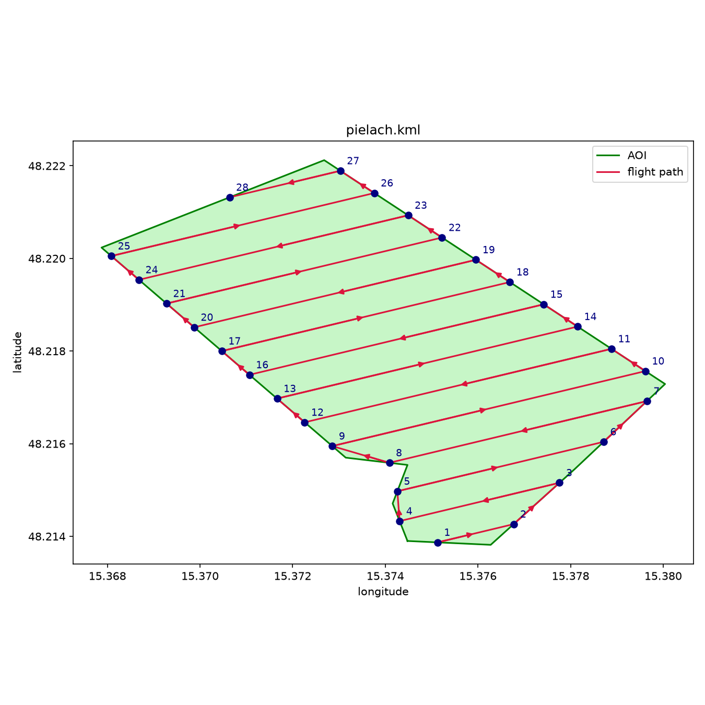

# UAV-LiDAR flight planning tool
A project written for the course Python-Programmierung für Geowissenschaften [120.113] @ TU Wien  
## Aim of the Project
The task  was to implement a simple tool to create flight plans for UAV-LiDAR surveys.  
The tool takes an area-of-interest polygon and basic flight mission parameters as input and returns a waypoint kml file as output.  
The tool is available as an importable module aswell as support for calls from the commandline and a QGIS processing script
## Features
- **Input**: an AOI polygon, given as a GeoJSON file (`.geojson`/`.json`) or Plaintext (lon;lat\n).
- **Planning**: the polygon is projected into a local metric coordinate system (UTM, auto-detected from the AOI's location unless an EPSG code is given), and flight lines are generated according to the chosen mission type:
   - **`single_grid`** : a back and forth raster across the AOI.
   - **`double_grid`** : two rasters orthogonal to each other for denser coverage.
   - **`corridor`** : (not in this version) follows the centerline of a long, narrow AOI (road, river, ...) instead of a straight raster, the flight tracks bends in the corridor and supports multiple parallel lines if the corridor is wider than one sensor swath.
- **Metrics**: swath width, line spacing, number of lines, estimated point density, total flight length, and flight duration are computed and printed to the console.
- **Output**: the flight plan is exported as a KML file containing numbered waypoint placemarks and the full flight path as a line.
## Installation
### As Module
Clone the repository and run `python -m pip install [path to the repo]` using the python environment you'd like to install the Module in. Use the `-e` flag to install in editable mode. Alternatively drop the ./uavplanner/ Folder into the desired environments site-package directory and install the required dependecies manually:
- shapely
- simplekml
- pyproj
### As QGIS-processing-script
Double click the `install-in-qgis.bat` file, to attempt to automatically install the module and its dependencies into the qgis environment (experimental).

**Manual install:** Open the osgeo4w shell (comes with qgis) and run `python -m pip install [path to the repo]`. Might require admin priviliges, alternatively use the --user flag with pip.
After this add the `plan_flight_lines.py` file to the QGIS toolbox. 
## Usage
### Command Line
`python -m uavplanner [input] [options]`
| Option | Description |
|---|---|
| `input` (positional) | AOI polygon file (`.geojson`/`.json`/`.txt`) |
| `-o`, `--output` | Output KML path (default: `mission.kml`) |
| `--altitude` | Flying altitude in meters (required) |
| `--velocity` | Flight speed in m/s (required) |
| `--fov` | Scanner field of view, full angle in degrees (required) |
| `--azimuth` | Main flight direction in degrees clockwise from north, or `auto` (default) to pick the shortest path automatically |
| `--overlap` | Swath overlap as a fraction 0–1 (default: `0.3`) |
| `--lead-in` | Line extension on both ends in meters, for sensor warm-up (default: `0`) |
| `--mission` | Mission type: `single_grid`, `double_grid` (default: `single_grid`) |
| `--prf` | Pulse repetition frequency in Hz, enables a point density estimate |
| `--epsg` | Projected EPSG code to use (default: automatically picked UTM zone) |
| `--restricted` | Keep transit paths between flight lines inside the AOI (no flying outside the polygon) |
### QGIS
1) Create a new shapefile layer with type Polygon
2) Draw a Polygon
3) Click on the script in the toolbox, input arguments and run
4) The result is saved as a kml file and reloaded onto the map

## Structure
```
uavplanner/
├── __init__.py        Marks uavplanner as a Python package
├── __main__.py        Imports and calls cli.main()
├── cli.py             Command-line argument parsing and console output
├── crs.py             Coordinate reference system handling (WGS84, projected UTM)
├── geometry.py        Core raster flight-line generation, automatic azimuth optimization, transit routing
├── metrics.py         Swath width, line spacing, point density, and parameter validation
├── missions.py        Mission type registry
├── planner_types.py   Data structures(MissionParams, Waypoint, FlightLine, Metrics, FlightPlan)
├── planner.py         Responsible for (validate, project, generate lines, route transits, compute metrics, export)
├── reader.py          AOI file readers (GeoJSON, plain-text coordinate lists)
└── writer.py          KML export
```
## Examples
```
python -m uavplanner .\sample_aoi\pielach.geojson -o pielach.kml --altitude 70 --velocity 15 --fov 70

OUTPUT:
mission type:         single_grid
flight azimuth:       70 deg (auto)
projected CRS:        EPSG:32633
swath width:          98.0 m
line spacing:         68.6 m
flight lines:         14
total length:         6882 m
est. duration:        7.6 min
```


## Limitations
### Restricted flag
Currently no wayfinding algorythm implemented, workaround is finishing each arm first incase of a split and simple implementation of a "go along the exterior ring to not leave the AOI". Works in most cases. Problems: Polygons with holes dont raise but produce no usable results. 
### Waypoint handling by DJI
There is a case where the transit segments are unnecessary (and probably even counterproductive) if DJI drones calculate them during flight, in that case the code needs to be adjusted to only generate the flightlines.
### Installation in QGIS
Is harder than expected because `sys.executable` in qgis python points to `qgis-bin.exe` instead of `python.exe`. Fully robust way of installation not worked out yet.
### File handling by DJI
It cant be guaranteed that the Drone can read the plain kml file without doing extra steps converting it to kmz along with dji specific metadata. A real concern here is how velocity is read from the kml file or the kmz archive.

## How it Works
The planner runs a fixed pipeline (`plan_mission` in `planner.py`):

1. **Validate** the mission parameters.
2. **Project** the AOI polygon from WGS84 into a local metric CRS (auto-picked UTM zone, or the given EPSG) so distances are in meters.
3. **Compute spacing** from the flight geometry: swath width follows from altitude and field of view, line spacing from swath width and the requested overlap.
4. **Pick azimuth** if set to `auto`, by testing directions and keeping the one with the shortest total path.
5. **Generate flight lines** using the chosen mission strategy (`single_grid`, `double_grid`, `corridor`).
6. **Route transits** between consecutive lines (kept inside the AOI when `--restricted`).
7. **Compute metrics** (line count, length, duration, point density).
8. **Unproject** lines back to WGS84 and **export** as a KML of numbered waypoints plus the flight path.

## Trivia
Longitude and Latitude made us sad:(  
Without Dijkstra-Algorithm the drone flies mad.
